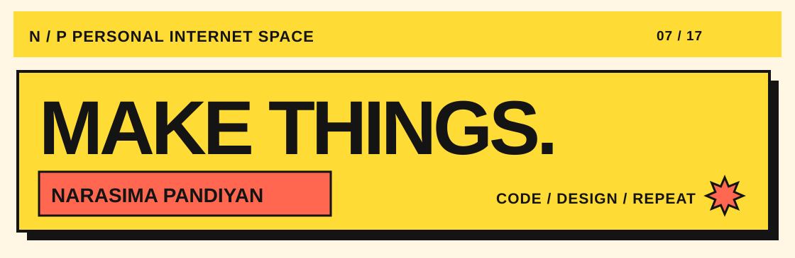
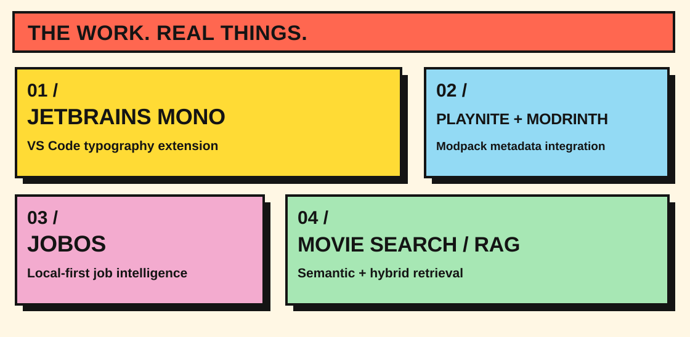

<!-- GitHub profile / Neo-Brutalism 07. Semantic Markdown content accompanies all SVG artwork. -->
<picture>
  <source media="(max-width: 620px) and (prefers-color-scheme: dark)" srcset="./assets/neo-hero-mobile-dark.svg">
  <source media="(max-width: 620px)" srcset="./assets/neo-hero-mobile-light.svg">
  <source media="(prefers-color-scheme: dark)" srcset="./assets/neo-hero-dark.svg">
  
</picture>

# Narasima Pandiyan

**BIG IDEAS. WORKING CODE.**

Software developer and designer working across web applications, AI systems, and developer tooling. I care about thoughtful interfaces, practical engineering, and building things people can actually use.

**[Portfolio](https://narasima.codes)** &nbsp; / &nbsp; **[Email](mailto:sayhi@narasima.codes)** &nbsp; / &nbsp; **[GitHub](https://github.com/NarasimaPandiyan)**

---

<picture>
  <source media="(max-width: 620px) and (prefers-color-scheme: dark)" srcset="./assets/neo-projects-mobile-dark.svg">
  <source media="(max-width: 620px)" srcset="./assets/neo-projects-mobile-light.svg">
  <source media="(prefers-color-scheme: dark)" srcset="./assets/neo-projects-dark.svg">
  
</picture>

## WHAT'S ON THE BENCH?

### 01 / [JetBrains Mono for VS Code](https://github.com/NarasimaPandiyan/JetbrainsMono-vscode-extension)
A VS Code extension for enabling and managing the JetBrains Mono font family.  
`EDITOR TOOLING` &nbsp; `VS CODE`

### 02 / [Playnite × Modrinth](https://github.com/NarasimaPandiyan/Playnite-Modrinth-Metadata)
A Playnite metadata-provider extension that brings Minecraft modpack information and artwork from Modrinth into Playnite.  
`C#` &nbsp; `API INTEGRATION`

### 03 / [JobOS](https://github.com/NarasimaPandiyan/jobOS)
A **work-in-progress**, local-first job intelligence and structured résumé-building system.  
`TAURI` &nbsp; `LOCAL AI` &nbsp; `IN PROGRESS`

### 04 / [Movie recommendation with RAG](https://github.com/NarasimaPandiyan/Movie-Recommendation-Using-RAG)
Semantic and hybrid movie search using Gemini embeddings, LlamaIndex, and MongoDB Atlas.  
`PYTHON` &nbsp; `RAG`

---

## TOOLBOX / 05

`Python` &nbsp; `TypeScript` &nbsp; `React` &nbsp; `C#` &nbsp; `PyTorch` &nbsp; `Tauri`

Also exploring game development, simulation, UI/UX design, and Japanese language learning.

---

## THE LOG / 06

<strong>Activity log</strong> — GitHub and WakaTime statistics

<!--START_SECTION:waka-->
<!--END_SECTION:waka-->

<strong>Personal note</strong> — Technoblade

> Those who treat me with kindness, I will repay that kindness tenfold.

In memory of Technoblade. [Original memorial animation](./Assets/Techno-RIP.gif) · [Animation credit to SAD-ist](https://youtu.be/MPiILYNStd8?t=50).

---

BUILD / BREAK / LEARN / REPEAT &nbsp; · &nbsp; [narasima.codes](https://narasima.codes)
