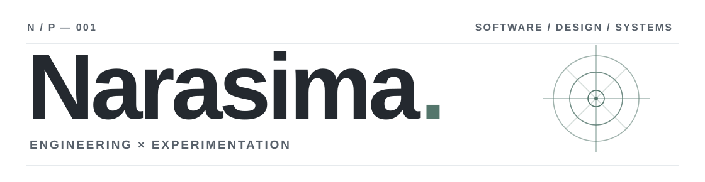

<!-- Minimal editorial GitHub profile • source: github.com/NarasimaPandiyan/NarasimaPandiyan -->
<picture>
  <source media="(max-width: 620px) and (prefers-color-scheme: dark)" srcset="./assets/header-mobile-dark.svg">
  <source media="(max-width: 620px)" srcset="./assets/header-mobile-light.svg">
  <source media="(prefers-color-scheme: dark)" srcset="./assets/header-dark.svg">
  
</picture>

**Multidisciplinary developer / generalist.**  
I build across software engineering, applied AI, and developer tooling — with an interest in thoughtful interfaces and useful systems.

[Portfolio](https://narasima.codes) &nbsp;·&nbsp; [Email](mailto:sayhi@narasima.codes) &nbsp;·&nbsp; [GitHub](https://github.com/NarasimaPandiyan)

---

### 01 / Selected work

**[JetBrains Mono for VS Code](https://github.com/NarasimaPandiyan/JetbrainsMono-vscode-extension)**  
A VS Code extension for enabling and managing the JetBrains Mono font family.  
`EDITOR TOOLING` &nbsp; `VS CODE`

**[Playnite × Modrinth](https://github.com/NarasimaPandiyan/Playnite-Modrinth-Metadata)**  
A metadata provider that brings Minecraft modpack information and artwork from Modrinth into Playnite.  
`C#` &nbsp; `API INTEGRATION`

**[JobOS](https://github.com/NarasimaPandiyan/jobOS)**  
An in-progress, local-first job intelligence and structured resume-building system.  
`TAURI` &nbsp; `LOCAL AI` &nbsp; `IN PROGRESS`

**[Movie recommendations with RAG](https://github.com/NarasimaPandiyan/Movie-Recommendation-Using-RAG)**  
Semantic and hybrid movie search using Gemini embeddings, LlamaIndex, and MongoDB Atlas.  
`PYTHON` &nbsp; `RAG`

---

### 02 / Working with

`Python` &nbsp; `TypeScript` &nbsp; `React` &nbsp; `C#` &nbsp; `PyTorch` &nbsp; `Tauri`

My interests also extend to game development, simulation, UI/UX design, and Japanese language learning.

---

### 03 / Activity

GitHub and coding activity · generated automatically

<!--START_SECTION:waka-->
<!--END_SECTION:waka-->

---

A personal note · Technoblade

> Those who treat me with kindness, I will repay that kindness tenfold.

In memory of Technoblade. The tribute from my original profile is preserved [here](./Assets/Techno-RIP.gif), with [animation credit to SAD-ist](https://youtu.be/MPiILYNStd8?t=50).

Less decoration. More substance. · [narasima.codes](https://narasima.codes)
